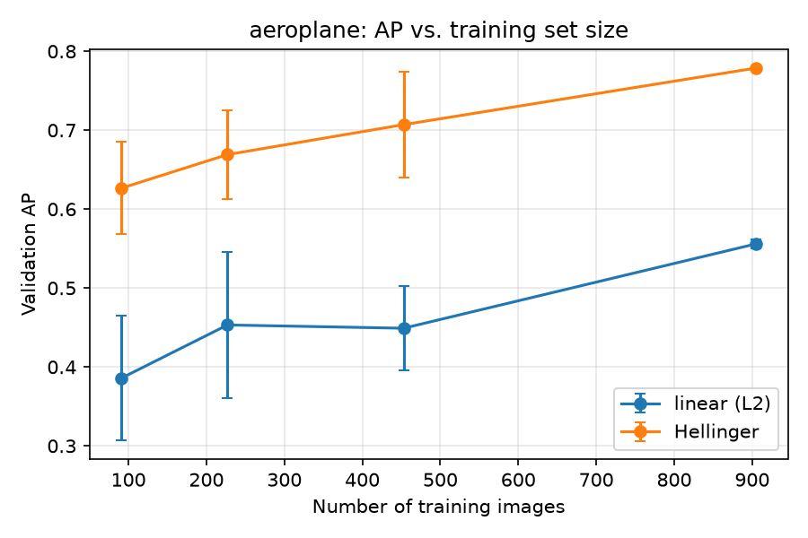
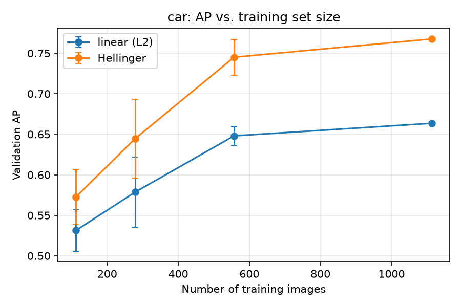
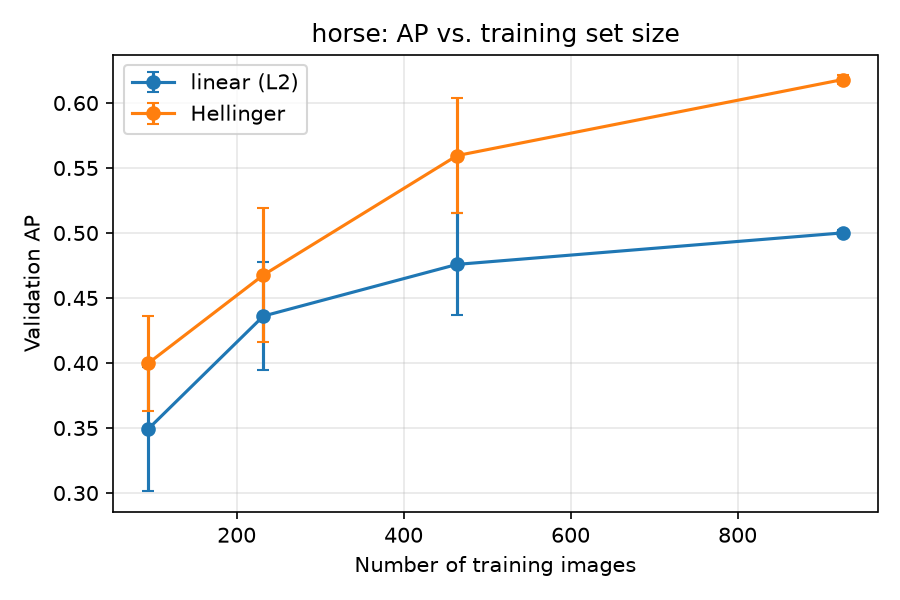
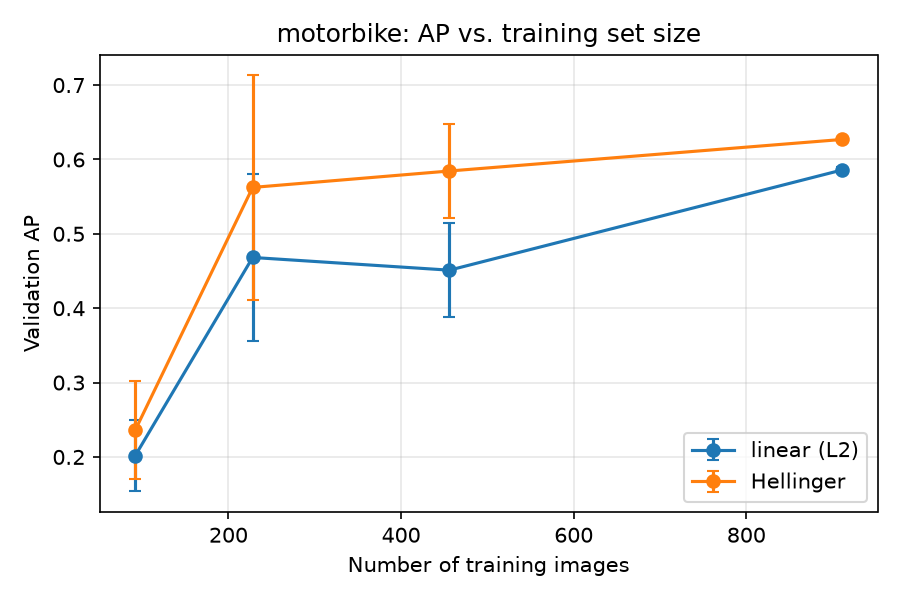
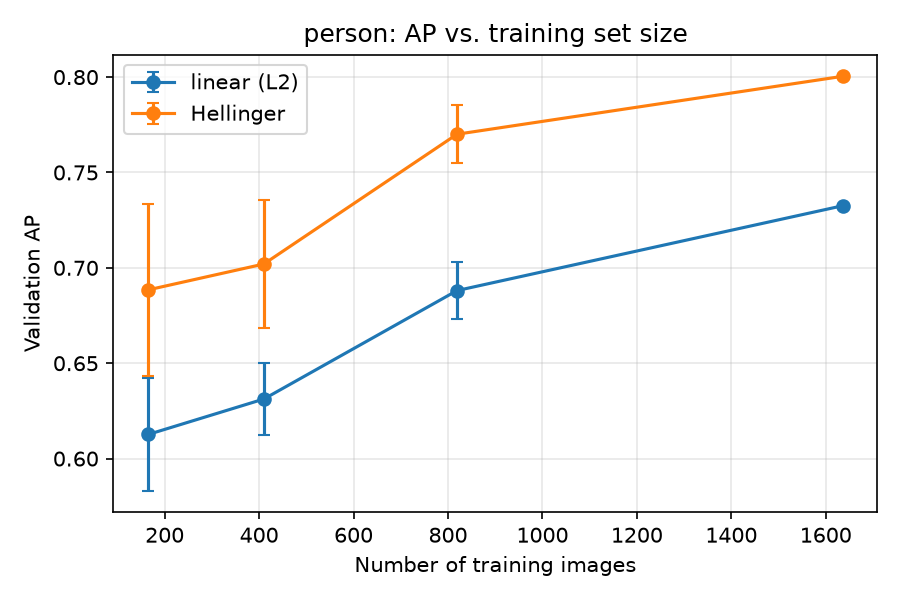

# Part 1 — Handcrafted features: BoVW and linear SVM

Linear SVM (C fixed) per category, positives vs. background, on the protocol splits. Values are test AP; mAP is the mean over categories.

## Stages A, E, F — vocabulary size, spatial tiling and feature map

Test mAP. Rows: vocabulary size K and spatial layout (`2x2 tiles`: 4 concatenated histograms, dimension 4K; `global`: one histogram, dimension K). Columns: feature map (normalization); `sqrt_l2` is the Hellinger map.

|    K | spatial   |    l1 |    l2 |   none |   sqrt |   sqrt_l1 |   sqrt_l2 |
|-----:|:----------|------:|------:|-------:|-------:|----------:|----------:|
|  256 | 2x2 tiles | 0.542 | 0.578 |  0.511 |  0.586 |     0.558 |     0.680 |
|  256 | global    | 0.545 | 0.573 |  0.504 |  0.537 |     0.536 |     0.635 |
|  512 | 2x2 tiles | 0.544 | 0.591 |  0.567 |  0.636 |     0.562 |     0.691 |
|  512 | global    | 0.546 | 0.572 |  0.518 |  0.586 |     0.560 |     0.668 |
| 1024 | 2x2 tiles | 0.541 | 0.593 |  0.589 |  0.678 |     0.551 |     0.707 |
| 1024 | global    | 0.539 | 0.585 |  0.560 |  0.601 |     0.554 |     0.686 |

## Stages D, E — per-category test AP (K = 512)

| spatial   | feature_map   |   aeroplane |   car |   horse |   motorbike |   person |   mAP |
|:----------|:--------------|------------:|------:|--------:|------------:|---------:|------:|
| 2x2 tiles | l1            |       0.601 | 0.640 |   0.539 |       0.361 |    0.579 | 0.544 |
| 2x2 tiles | l2            |       0.516 | 0.671 |   0.554 |       0.517 |    0.695 | 0.591 |
| 2x2 tiles | none          |       0.638 | 0.631 |   0.502 |       0.437 |    0.626 | 0.567 |
| 2x2 tiles | sqrt          |       0.658 | 0.706 |   0.622 |       0.514 |    0.680 | 0.636 |
| 2x2 tiles | sqrt_l1       |       0.532 | 0.654 |   0.577 |       0.437 |    0.608 | 0.562 |
| 2x2 tiles | sqrt_l2       |       0.688 | 0.734 |   0.672 |       0.603 |    0.759 | 0.691 |
| global    | l1            |       0.641 | 0.614 |   0.498 |       0.357 |    0.618 | 0.546 |
| global    | l2            |       0.490 | 0.669 |   0.548 |       0.457 |    0.696 | 0.572 |
| global    | none          |       0.533 | 0.596 |   0.452 |       0.393 |    0.617 | 0.518 |
| global    | sqrt          |       0.599 | 0.678 |   0.558 |       0.420 |    0.673 | 0.586 |
| global    | sqrt_l1       |       0.624 | 0.649 |   0.512 |       0.411 |    0.602 | 0.560 |
| global    | sqrt_l2       |       0.684 | 0.737 |   0.658 |       0.503 |    0.755 | 0.668 |

## Stage E — effect of spatial tiling per category (K = 512, Hellinger)

| category   |   2x2 tiles |   global |   tiles - global |
|:-----------|------------:|---------:|-----------------:|
| aeroplane  |       0.688 |    0.684 |            0.003 |
| car        |       0.734 |    0.737 |           -0.003 |
| horse      |       0.672 |    0.658 |            0.014 |
| motorbike  |       0.603 |    0.503 |            0.099 |
| person     |       0.759 |    0.755 |            0.004 |

## Stages B, C, D — setting selected on validation AP, per category

A large train–test gap indicates overfitting.

| category   |    K | spatial   | feature_map   |   dim |   ap_train |   ap_val |   ap_test |   train - test |
|:-----------|-----:|:----------|:--------------|------:|-----------:|---------:|----------:|---------------:|
| aeroplane  |  512 | 2x2 tiles | sqrt_l2       |  2048 |      0.992 |    0.778 |     0.688 |          0.304 |
| car        |  512 | 2x2 tiles | sqrt_l2       |  2048 |      0.993 |    0.768 |     0.734 |          0.259 |
| horse      |  512 | 2x2 tiles | sqrt_l2       |  2048 |      0.999 |    0.619 |     0.672 |          0.327 |
| motorbike  | 1024 | 2x2 tiles | sqrt          |  4096 |      1.000 |    0.675 |     0.582 |          0.418 |
| person     |  512 | 2x2 tiles | sqrt_l2       |  2048 |      0.971 |    0.800 |     0.759 |          0.212 |

mAP (test) of the selected settings: **0.687**

## Stage G — training set size

Validation AP, mean ± std over seeds (stratified subsets). `l2` = linear kernel, `sqrt_l2` = Hellinger.

| category   | feature_map   | 0.1           | 0.25          | 0.5           | 1.0           |
|:-----------|:--------------|:--------------|:--------------|:--------------|:--------------|
| aeroplane  | l2            | 0.386 ± 0.079 | 0.453 ± 0.093 | 0.449 ± 0.053 | 0.556 ± 0.006 |
| aeroplane  | sqrt_l2       | 0.627 ± 0.058 | 0.669 ± 0.057 | 0.707 ± 0.067 | 0.779 ± 0.001 |
| car        | l2            | 0.531 ± 0.026 | 0.579 ± 0.043 | 0.648 ± 0.012 | 0.664 ± 0.002 |
| car        | sqrt_l2       | 0.573 ± 0.034 | 0.645 ± 0.049 | 0.745 ± 0.022 | 0.768 ± 0.001 |
| horse      | l2            | 0.349 ± 0.048 | 0.436 ± 0.042 | 0.476 ± 0.039 | 0.500 ± 0.002 |
| horse      | sqrt_l2       | 0.400 ± 0.037 | 0.468 ± 0.051 | 0.560 ± 0.044 | 0.618 ± 0.003 |
| motorbike  | l2            | 0.202 ± 0.048 | 0.468 ± 0.112 | 0.451 ± 0.063 | 0.586 ± 0.004 |
| motorbike  | sqrt_l2       | 0.236 ± 0.066 | 0.562 ± 0.151 | 0.584 ± 0.063 | 0.627 ± 0.000 |
| person     | l2            | 0.613 ± 0.030 | 0.631 ± 0.019 | 0.688 ± 0.015 | 0.733 ± 0.000 |
| person     | sqrt_l2       | 0.688 ± 0.045 | 0.702 ± 0.034 | 0.770 ± 0.015 | 0.800 ± 0.001 |

Mean training set size per fraction (positives in `num_pos`):

|   fraction |   num_train |   num_pos |
|-----------:|------------:|----------:|
|      0.100 |     111.000 |    29.000 |
|      0.250 |     275.000 |    71.000 |
|      0.500 |     550.000 |   142.000 |
|      1.000 |    1098.000 |   283.000 |

## Stages B, C — visual inspection

Ranked image lists, precision–recall curves and relevant visual words are in `1_handcraft.ipynb`.

## Questions

**Stage A**

- How do you choose the number of visual words for BoVW?
  - *Answer:*
- How does spatial tiling encode useful layout information? When might it reduce generalization?
  - *Answer:*
- How does vocabulary size affect representation capacity, quantization error, computation and storage?
  - *Answer:*

**Stage B**

- What do you anticipate the results to be? What do you predict will occur?
  - *Answer:*
- Do the highest-ranked images share object features, contextual cues or background patterns?
  - *Answer:*
- Why can a classifier achieve high training performance but fail on new images?
  - *Answer:*

**Stage C**

- Why is the bias term irrelevant to the ordering of images scored by one fixed binary linear classifier?
  - *Answer:*
- How does the ordering of positive and negative examples affect the precision-recall curve and AP?
  - *Answer:*

**Stage D**

- How do intra-class variation, sample count, object scale and background diversity help explain differences in AP?
  - *Answer:*

**Stage E**

- How does L2 normalization affect the self-similarity of a nonzero feature vector under a linear kernel?
  - *Answer:*
- Regarding the L2 normalized BoVW histogram h, what can be inferred about its self-similarity K(h,h)?
  - *Answer:*
- How does K(h,h) of an L2 normalized histogram compare to K(h,h') of two distinct L2 normalized histograms?
  - *Answer:*
- Would the same hold true for unnormalized or L1 normalized histograms?
  - *Answer:*
- Is there a correlation between classification performance and the use of L2 normalization?
  - *Answer:*
- Why can removing spatial information help some classes but hurt others?
  - *Answer:*

**Stage F**

- How should the BoVW histograms be normalized for the Hellinger kernel classifier? Before or after the square root?
  - *Answer:*
- Why does the square-root mapping change the relative contribution of frequent and rare visual words?
  - *Answer:*

**Stage G**

- What performance do you get with the linear kernel? And with the Hellinger kernel?
  - *Answer:*
- Does performance saturate? Would collecting more examples or improving their diversity likely help more?
  - *Answer:*

