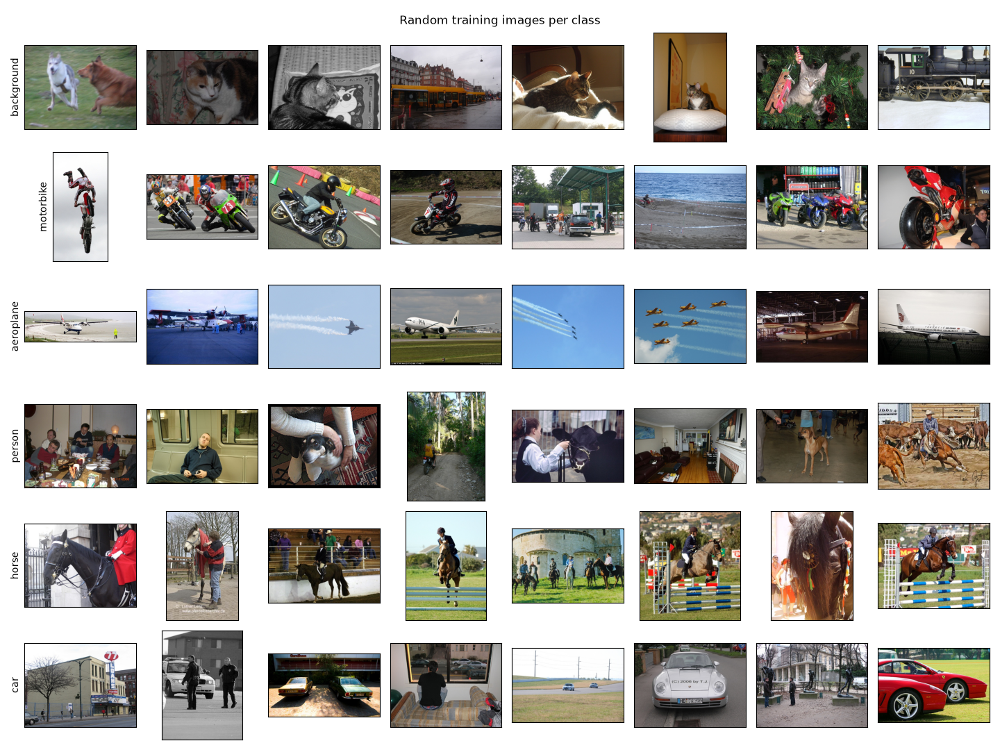
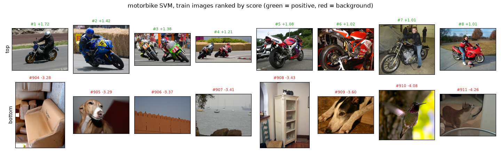
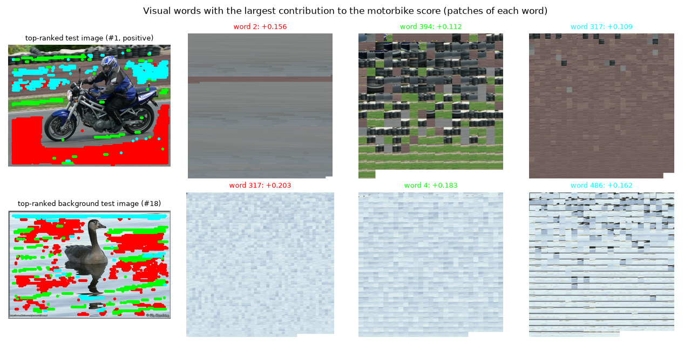
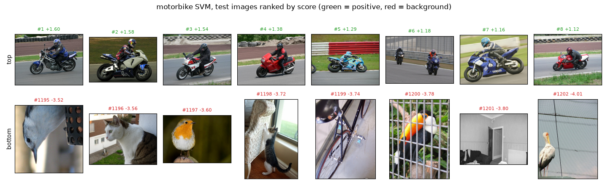
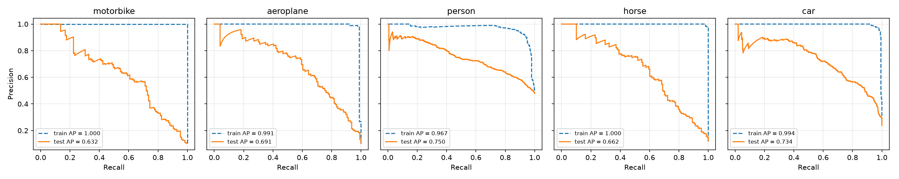
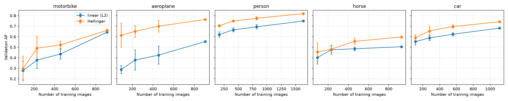

# Part 1 — Handcrafted features: BoVW and linear SVM

## Stage A — data, vocabulary size and spatial tiling

> Inspect the images; learn the vocabulary on training data only; compare one global histogram with spatial tiles; evaluate at least two vocabulary sizes besides the supplied K = 512.

Images per class and subset:

| class      |   train |   val |   test |
|:-----------|--------:|------:|-------:|
| motorbike  |      96 |    24 |    125 |
| aeroplane  |      90 |    22 |    126 |
| person     |     821 |   204 |    983 |
| horse      |     111 |    28 |    148 |
| car        |     298 |    78 |    337 |
| background |     815 |   204 |   1077 |

Per vocabulary size, Hellinger map. `qerr`: mean squared distance of a SIFT descriptor to its nearest word / total SIFT variance (`runs.quantization`, 100 images per subset). Codebook fit and SIFT + encoding time per image (5 images, CPU) measured by `run_part3`. Storage: tiled histogram as stored (int64). SVM training and inference (per test image): mean over categories.

|    K |   dim (tiles) |   val mAP (tiles) |   val mAP (global) |   qerr (train) |   qerr (test) |   codebook_fit_s |   extract_ms |   kb_per_image |   svm_train_s |   infer_us |
|-----:|--------------:|------------------:|-------------------:|---------------:|--------------:|-----------------:|-------------:|---------------:|--------------:|-----------:|
|  256 |          1024 |             0.705 |              0.640 |          0.476 |         0.484 |           31.093 |      180.323 |          8.000 |         0.071 |      9.933 |
|  512 |          2048 |             0.717 |              0.668 |          0.445 |         0.453 |           63.996 |      221.215 |         16.000 |         0.146 |     19.836 |
| 1024 |          4096 |             0.712 |              0.699 |          0.418 |         0.427 |           87.136 |      304.102 |         32.000 |         0.291 |     38.752 |

## Stage B — motorbike classifier

> Motorbike images as positives, background as negatives, linear SVM on BoVW; rank the training images by score; visualize the visual words associated with high classifier weights.

Motorbike AP on the training images and on held-out images (K = 512, 2x2 tiles), per feature map:

| feature_map   |   ap_train |   ap_val |   ap_test |
|:--------------|-----------:|---------:|----------:|
| none          |      1.000 |    0.568 |     0.413 |
| l1            |      0.804 |    0.533 |     0.359 |
| l2            |      0.948 |    0.646 |     0.513 |
| sqrt          |      1.000 |    0.668 |     0.552 |
| sqrt_l1       |      0.645 |    0.558 |     0.444 |
| sqrt_l2       |      1.000 |    0.660 |     0.632 |

Visual words with the largest contribution to the score (SVM weight, averaged over the tiles, × Hellinger histogram), for the top-ranked test image and the highest-ranked background test image. Each mosaic shows patches assigned to one word; dots of the same colour mark them in the image.

## Stage C — test set: ranking, precision–recall curve and AP

> Apply the motorbike classifier to the test set, rank the images by the SVM score, plot the precision–recall curve and report AP.

Motorbike test AP = **0.632**; 28 of the 36 top-ranked test images are motorbikes (test set: 125 motorbikes, 1077 background images).

Classification at the SVM's own threshold (score > 0): precision = 0.701, recall = 0.488 (87 images predicted positive). Confusion matrix on test:

| true \ predicted   |   motorbike |   background |
|:-------------------|------------:|-------------:|
| motorbike          |          61 |           64 |
| background         |          26 |         1051 |

AP and the precision–recall curve depend only on the order of the scores; the bias b only sets where the score > 0 threshold falls on that curve.

Precision–recall curves on the training images (dashed) and on the test set (solid):

## Stage D — other categories

> The same experiment for aeroplane, person, horse and car, same splits and protocol; per-class AP.

K = 512, 2x2 tiles, `sqrt_l2`. Test mAP = **0.694**. `normalized AP` = (AP − random AP) / (1 − random AP): raw AP is not comparable across classes with different shares of positives.

| category   |   train positives |   test positives |   random AP |   ap_train |   ap_val |   ap_test |   normalized AP |   test_top36_pos |   precision (s>0) |   recall (s>0) |   TP |   FP |   FN |   TN |
|:-----------|------------------:|-----------------:|------------:|-----------:|---------:|----------:|----------------:|-----------------:|------------------:|---------------:|-----:|-----:|-----:|-----:|
| motorbike  |                96 |              125 |       0.104 |      1.000 |    0.660 |     0.632 |           0.589 |               28 |             0.701 |          0.488 |   61 |   26 |   64 | 1051 |
| aeroplane  |                90 |              126 |       0.105 |      0.991 |    0.765 |     0.691 |           0.654 |               32 |             0.768 |          0.500 |   63 |   19 |   63 | 1058 |
| person     |               821 |              983 |       0.477 |      0.967 |    0.820 |     0.750 |           0.523 |               33 |             0.677 |          0.690 |  678 |  323 |  305 |  754 |
| horse      |               111 |              148 |       0.121 |      1.000 |    0.596 |     0.662 |           0.615 |               33 |             0.695 |          0.554 |   82 |   36 |   66 | 1041 |
| car        |               298 |              337 |       0.238 |      0.994 |    0.741 |     0.734 |           0.651 |               30 |             0.677 |          0.665 |  224 |  107 |  113 |  970 |

Test images of each class (rows) also labelled with another class (columns). The negatives of every task are background images only, so images of the other classes are never scored:

| class     | motorbike   | aeroplane   | person   | horse   | car   | background   |
|:----------|:------------|:------------|:---------|:--------|:------|:-------------|
| motorbike | ·           | –           | 85       | –       | 17    | –            |
| aeroplane | –           | ·           | 12       | –       | 2     | –            |
| person    | 85          | 12          | ·        | 116     | 103   | –            |
| horse     | –           | –           | 116      | ·       | 4     | –            |
| car       | 17          | 2           | 103      | 4       | ·     | –            |

## Stage E — normalization and spatial information

> No normalization vs. L1 vs. L2, selected on validation; 2x2 tiles vs. one global histogram.

Validation mAP:

|    K | spatial   |   none |    l1 |    l2 |
|-----:|:----------|-------:|------:|------:|
|  256 | 2x2 tiles |  0.557 | 0.559 | 0.621 |
|  256 | global    |  0.568 | 0.565 | 0.556 |
|  512 | 2x2 tiles |  0.607 | 0.570 | 0.628 |
|  512 | global    |  0.573 | 0.576 | 0.575 |
| 1024 | 2x2 tiles |  0.592 | 0.558 | 0.604 |
| 1024 | global    |  0.552 | 0.555 | 0.562 |

Effect of the tiles per category (K = 512, `sqrt_l2`):

| category   |   test: 2x2 tiles |   test: global |   test: tiles − global |   val: tiles − global |
|:-----------|------------------:|---------------:|-----------------------:|----------------------:|
| motorbike  |             0.632 |          0.523 |                  0.109 |                 0.137 |
| aeroplane  |             0.691 |          0.682 |                  0.008 |                 0.085 |
| person     |             0.750 |          0.752 |                 -0.001 |                 0.021 |
| horse      |             0.662 |          0.645 |                  0.017 |                -0.010 |
| car        |             0.734 |          0.745 |                 -0.011 |                 0.009 |

## Stage F — Hellinger feature map

> Square root of the histogram + normalization (Hellinger kernel as an explicit feature map), compared with the other normalizations; motorbike retrained and evaluated on test.

Validation mAP (`l2` = linear kernel, for reference):

|    K | spatial   |    l2 |   sqrt |   sqrt_l1 |   sqrt_l2 |
|-----:|:----------|------:|-------:|----------:|----------:|
|  256 | 2x2 tiles | 0.621 |  0.630 |     0.608 |     0.705 |
|  256 | global    | 0.556 |  0.553 |     0.561 |     0.640 |
|  512 | 2x2 tiles | 0.628 |  0.680 |     0.597 |     0.717 |
|  512 | global    | 0.575 |  0.622 |     0.563 |     0.668 |
| 1024 | 2x2 tiles | 0.604 |  0.705 |     0.577 |     0.712 |
| 1024 | global    | 0.562 |  0.604 |     0.574 |     0.699 |

Test AP, linear (`l2`) vs. Hellinger (`sqrt_l2`), K = 512, 2x2 tiles:

| feature_map   |   motorbike |   aeroplane |   person |   horse |   car |   mAP |
|:--------------|------------:|------------:|---------:|--------:|------:|------:|
| l2            |       0.513 |       0.521 |    0.695 |   0.560 | 0.676 | 0.593 |
| sqrt_l2       |       0.632 |       0.691 |    0.750 |   0.662 | 0.734 | 0.694 |

## Stage G — number of training images

> Train with 10, 25, 50 and 100 % of the training data, several seeds; validation AP against the number of training examples; linear vs. Hellinger.

Validation AP, mean ± std over 5 seeds (stratified subsets; at 100 % every seed uses the same images). `l2` = linear kernel, `sqrt_l2` = Hellinger; K = 512, 2x2 tiles.

| category   | feature_map   | 0.1           | 0.25          | 0.5           | 1.0           |
|:-----------|:--------------|:--------------|:--------------|:--------------|:--------------|
| motorbike  | l2            | 0.278 ± 0.088 | 0.378 ± 0.079 | 0.435 ± 0.049 | 0.643 ± 0.001 |
| motorbike  | sqrt_l2       | 0.296 ± 0.119 | 0.490 ± 0.115 | 0.522 ± 0.036 | 0.660 ± 0.000 |
| aeroplane  | l2            | 0.287 ± 0.039 | 0.378 ± 0.096 | 0.425 ± 0.086 | 0.554 ± 0.002 |
| aeroplane  | sqrt_l2       | 0.613 ± 0.114 | 0.651 ± 0.057 | 0.700 ± 0.057 | 0.764 ± 0.001 |
| person     | l2            | 0.620 ± 0.026 | 0.665 ± 0.020 | 0.694 ± 0.021 | 0.749 ± 0.000 |
| person     | sqrt_l2       | 0.704 ± 0.010 | 0.749 ± 0.008 | 0.775 ± 0.016 | 0.819 ± 0.000 |
| horse      | l2            | 0.401 ± 0.061 | 0.476 ± 0.043 | 0.485 ± 0.017 | 0.504 ± 0.001 |
| horse      | sqrt_l2       | 0.455 ± 0.084 | 0.481 ± 0.028 | 0.556 ± 0.030 | 0.597 ± 0.001 |
| car        | l2            | 0.554 ± 0.033 | 0.589 ± 0.026 | 0.623 ± 0.015 | 0.682 ± 0.000 |
| car        | sqrt_l2       | 0.590 ± 0.030 | 0.654 ± 0.047 | 0.696 ± 0.016 | 0.742 ± 0.001 |
| mAP        | l2            | 0.428 ± 0.025 | 0.497 ± 0.031 | 0.532 ± 0.018 | 0.626 ± 0.001 |
| mAP        | sqrt_l2       | 0.532 ± 0.027 | 0.605 ± 0.032 | 0.650 ± 0.011 | 0.716 ± 0.000 |

Positive training images per fraction (the negatives are subsampled in the same proportion):

| category   |   0.1 |   0.25 |   0.5 |   1.0 |
|:-----------|------:|-------:|------:|------:|
| motorbike  |    10 |     24 |    48 |    96 |
| aeroplane  |     9 |     23 |    45 |    90 |
| person     |    83 |    206 |   411 |   821 |
| horse      |    12 |     28 |    56 |   111 |
| car        |    30 |     75 |   149 |   298 |

