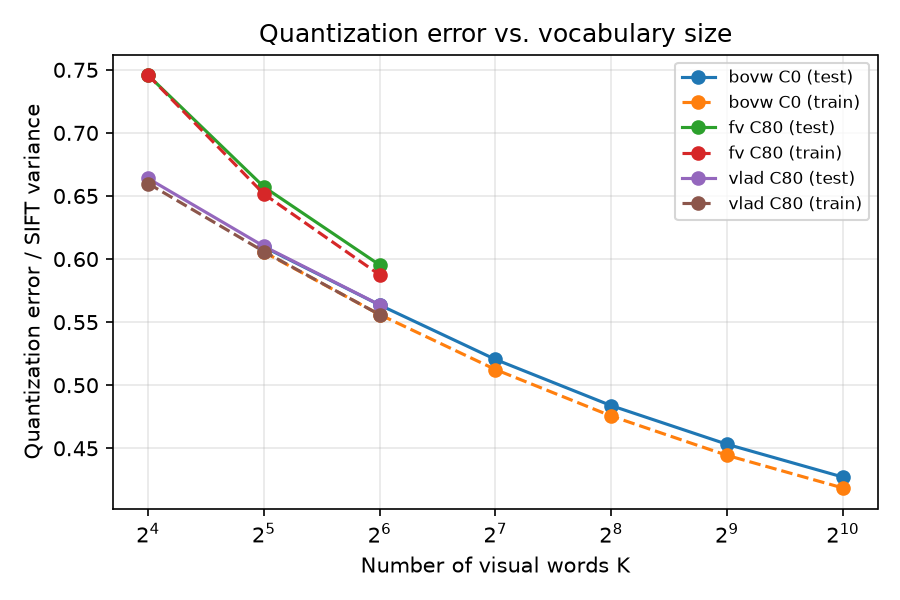

# Part 3 — Large visual vocabularies with PCA vs. smaller vocabularies

BoVW uses global histograms (dimension = K) with the Hellinger map; VLAD / FV use the Part 2 setting. PCA is fit on the training features only and followed by L2. Each seed trains on a different stratified subset of the training set.

## Recognition, compactness and efficiency

`pca_dim` 0 = no PCA. mAP is mean ± std over seeds; accuracy and macro-F1 use the SVM threshold 0.

| encoding      |   pca_dim |   orig_dim |   dim | mAP           |   acc |   macro_f1 |   pca_fit_s |   train_s |   infer_ms |   removed_% |
|:--------------|----------:|-----------:|------:|:--------------|------:|-----------:|------------:|----------:|-----------:|------------:|
| bovw_K32_C0   |         0 |         32 |    32 | 0.502 ± 0.001 | 0.828 |      0.601 |       0.000 |     0.004 |      0.000 |       0.000 |
| bovw_K64_C0   |         0 |         64 |    64 | 0.551 ± 0.003 | 0.840 |      0.623 |       0.000 |     0.006 |      0.000 |       0.000 |
| bovw_K64_C0   |        32 |         64 |    32 | 0.537 ± 0.004 | 0.836 |      0.623 |       0.002 |     0.003 |      0.000 |      50.000 |
| bovw_K128_C0  |         0 |        128 |   128 | 0.590 ± 0.004 | 0.848 |      0.644 |       0.000 |     0.010 |      0.000 |       0.000 |
| bovw_K128_C0  |        32 |        128 |    32 | 0.566 ± 0.002 | 0.841 |      0.650 |       0.009 |     0.003 |      0.000 |      75.000 |
| bovw_K128_C0  |        64 |        128 |    64 | 0.593 ± 0.009 | 0.849 |      0.709 |       0.014 |     0.005 |      0.001 |      50.000 |
| bovw_K256_C0  |         0 |        256 |   256 | 0.631 ± 0.004 | 0.855 |      0.699 |       0.000 |     0.018 |      0.000 |       0.000 |
| bovw_K256_C0  |        32 |        256 |    32 | 0.604 ± 0.009 | 0.851 |      0.696 |       0.013 |     0.003 |      0.001 |      87.500 |
| bovw_K256_C0  |        64 |        256 |    64 | 0.613 ± 0.006 | 0.851 |      0.724 |       0.022 |     0.005 |      0.001 |      75.000 |
| bovw_K256_C0  |       128 |        256 |   128 | 0.612 ± 0.004 | 0.849 |      0.728 |       0.045 |     0.009 |      0.001 |      50.000 |
| bovw_K512_C0  |         0 |        512 |   512 | 0.666 ± 0.004 | 0.864 |      0.735 |       0.000 |     0.036 |      0.000 |       0.000 |
| bovw_K512_C0  |        32 |        512 |    32 | 0.623 ± 0.003 | 0.856 |      0.711 |       0.024 |     0.003 |      0.001 |      93.750 |
| bovw_K512_C0  |        64 |        512 |    64 | 0.629 ± 0.007 | 0.856 |      0.737 |       0.030 |     0.005 |      0.001 |      87.500 |
| bovw_K512_C0  |       128 |        512 |   128 | 0.635 ± 0.005 | 0.855 |      0.738 |       0.056 |     0.009 |      0.001 |      75.000 |
| bovw_K512_C0  |       256 |        512 |   256 | 0.648 ± 0.005 | 0.860 |      0.754 |       0.119 |     0.018 |      0.003 |      50.000 |
| bovw_K1024_C0 |         0 |       1024 |  1024 | 0.682 ± 0.003 | 0.868 |      0.755 |       0.000 |     0.073 |      0.000 |       0.000 |
| bovw_K1024_C0 |        32 |       1024 |    32 | 0.633 ± 0.004 | 0.855 |      0.714 |       0.036 |     0.003 |      0.001 |      96.875 |
| bovw_K1024_C0 |        64 |       1024 |    64 | 0.636 ± 0.002 | 0.856 |      0.743 |       0.056 |     0.005 |      0.002 |      93.750 |
| bovw_K1024_C0 |       128 |       1024 |   128 | 0.654 ± 0.002 | 0.856 |      0.747 |       0.085 |     0.009 |      0.002 |      87.500 |
| bovw_K1024_C0 |       256 |       1024 |   256 | 0.660 ± 0.007 | 0.859 |      0.757 |       0.182 |     0.018 |      0.004 |      75.000 |
| bovw_K1024_C0 |       512 |       1024 |   512 | 0.669 ± 0.011 | 0.859 |      0.760 |       0.395 |     0.038 |      0.009 |      50.000 |
| vlad_K16_C80  |         0 |       5120 |  5120 | 0.705 ± 0.003 | 0.866 |      0.764 |       0.000 |     0.454 |      0.001 |       0.000 |
| vlad_K16_C80  |        32 |       5120 |    32 | 0.643 ± 0.005 | 0.852 |      0.713 |       0.118 |     0.003 |      0.004 |      99.375 |
| vlad_K16_C80  |        64 |       5120 |    64 | 0.663 ± 0.008 | 0.858 |      0.748 |       0.156 |     0.005 |      0.005 |      98.750 |
| vlad_K16_C80  |       128 |       5120 |   128 | 0.682 ± 0.003 | 0.860 |      0.758 |       0.220 |     0.008 |      0.009 |      97.500 |
| vlad_K16_C80  |       256 |       5120 |   256 | 0.679 ± 0.004 | 0.858 |      0.757 |       0.396 |     0.018 |      0.017 |      95.000 |
| vlad_K16_C80  |       512 |       5120 |   512 | 0.693 ± 0.005 | 0.858 |      0.761 |       0.865 |     0.040 |      0.038 |      90.000 |
| vlad_K32_C80  |         0 |      10240 | 10240 | 0.732 ± 0.006 | 0.871 |      0.767 |       0.000 |     0.880 |      0.002 |       0.000 |
| vlad_K32_C80  |        32 |      10240 |    32 | 0.677 ± 0.002 | 0.861 |      0.750 |       0.221 |     0.003 |      0.008 |      99.688 |
| vlad_K32_C80  |        64 |      10240 |    64 | 0.695 ± 0.007 | 0.863 |      0.761 |       0.323 |     0.005 |      0.011 |      99.375 |
| vlad_K32_C80  |       128 |      10240 |   128 | 0.703 ± 0.006 | 0.863 |      0.765 |       0.443 |     0.009 |      0.021 |      98.750 |
| vlad_K32_C80  |       256 |      10240 |   256 | 0.689 ± 0.006 | 0.858 |      0.759 |       0.826 |     0.018 |      0.041 |      97.500 |
| vlad_K32_C80  |       512 |      10240 |   512 | 0.717 ± 0.004 | 0.860 |      0.767 |       1.742 |     0.044 |      0.081 |      95.000 |
| vlad_K64_C80  |         0 |      20480 | 20480 | 0.765 ± 0.004 | 0.879 |      0.773 |       0.000 |     1.369 |      0.003 |       0.000 |
| vlad_K64_C80  |        32 |      20480 |    32 | 0.691 ± 0.003 | 0.865 |      0.761 |       0.395 |     0.003 |      0.015 |      99.844 |
| vlad_K64_C80  |        64 |      20480 |    64 | 0.729 ± 0.002 | 0.871 |      0.783 |       0.600 |     0.005 |      0.025 |      99.688 |
| vlad_K64_C80  |       128 |      20480 |   128 | 0.730 ± 0.002 | 0.867 |      0.780 |       0.836 |     0.010 |      0.040 |      99.375 |
| vlad_K64_C80  |       256 |      20480 |   256 | 0.715 ± 0.008 | 0.862 |      0.772 |       1.475 |     0.021 |      0.078 |      98.750 |
| vlad_K64_C80  |       512 |      20480 |   512 | 0.742 ± 0.007 | 0.861 |      0.776 |       3.143 |     0.049 |      0.162 |      97.500 |
| fv_K16_C80    |         0 |      10304 | 10304 | 0.766 ± 0.004 | 0.879 |      0.787 |       0.000 |     1.070 |      0.002 |       0.000 |
| fv_K16_C80    |        32 |      10304 |    32 | 0.672 ± 0.003 | 0.863 |      0.751 |       0.233 |     0.003 |      0.008 |      99.689 |
| fv_K16_C80    |        64 |      10304 |    64 | 0.710 ± 0.005 | 0.869 |      0.771 |       0.330 |     0.006 |      0.012 |      99.379 |
| fv_K16_C80    |       128 |      10304 |   128 | 0.720 ± 0.019 | 0.872 |      0.784 |       0.454 |     0.010 |      0.020 |      98.758 |
| fv_K16_C80    |       256 |      10304 |   256 | 0.735 ± 0.011 | 0.871 |      0.786 |       0.803 |     0.020 |      0.040 |      97.516 |
| fv_K16_C80    |       512 |      10304 |   512 | 0.750 ± 0.004 | 0.870 |      0.789 |       1.772 |     0.047 |      0.081 |      95.031 |
| fv_K32_C80    |         0 |      20608 | 20608 | 0.778 ± 0.004 | 0.884 |      0.784 |       0.000 |     2.095 |      0.004 |       0.000 |
| fv_K32_C80    |        32 |      20608 |    32 | 0.685 ± 0.004 | 0.863 |      0.755 |       0.448 |     0.003 |      0.015 |      99.845 |
| fv_K32_C80    |        64 |      20608 |    64 | 0.713 ± 0.004 | 0.867 |      0.766 |       0.573 |     0.005 |      0.022 |      99.689 |
| fv_K32_C80    |       128 |      20608 |   128 | 0.729 ± 0.007 | 0.871 |      0.784 |       0.773 |     0.009 |      0.039 |      99.379 |
| fv_K32_C80    |       256 |      20608 |   256 | 0.738 ± 0.007 | 0.869 |      0.783 |       1.440 |     0.018 |      0.068 |      98.758 |
| fv_K32_C80    |       512 |      20608 |   512 | 0.760 ± 0.003 | 0.870 |      0.790 |       2.982 |     0.043 |      0.159 |      97.516 |
| fv_K64_C80    |         0 |      41216 | 41216 | 0.797 ± 0.003 | 0.885 |      0.785 |       0.000 |     3.074 |      0.010 |       0.000 |
| fv_K64_C80    |        32 |      41216 |    32 | 0.705 ± 0.004 | 0.866 |      0.762 |       0.876 |     0.003 |      0.033 |      99.922 |
| fv_K64_C80    |        64 |      41216 |    64 | 0.732 ± 0.012 | 0.871 |      0.779 |       1.249 |     0.005 |      0.057 |      99.845 |
| fv_K64_C80    |       128 |      41216 |   128 | 0.756 ± 0.008 | 0.873 |      0.791 |       1.688 |     0.010 |      0.085 |      99.689 |
| fv_K64_C80    |       256 |      41216 |   256 | 0.759 ± 0.007 | 0.871 |      0.792 |       3.811 |     0.021 |      0.201 |      99.379 |
| fv_K64_C80    |       512 |      41216 |   512 | 0.783 ± 0.008 | 0.871 |      0.795 |       7.193 |     0.047 |      0.383 |      98.758 |

## Conditions C vs. D — same final dimension (BoVW, test mAP)

|   final_dim |   D: K = d, no PCA |   C: K = 64 + PCA |   C: K = 128 + PCA |   C: K = 256 + PCA |   C: K = 512 + PCA |   C: K = 1024 + PCA |
|------------:|-------------------:|------------------:|-------------------:|-------------------:|-------------------:|--------------------:|
|      32.000 |              0.502 |             0.537 |              0.566 |              0.604 |              0.623 |               0.633 |
|      64.000 |              0.551 |           nan     |              0.593 |              0.613 |              0.629 |               0.636 |
|     128.000 |              0.590 |           nan     |            nan     |              0.612 |              0.635 |               0.654 |
|     256.000 |              0.631 |           nan     |            nan     |            nan     |              0.648 |               0.660 |
|     512.000 |              0.666 |           nan     |            nan     |            nan     |            nan     |               0.669 |

## Per-category test AP

| encoding      |   pca_dim |   motorbike |   aeroplane |   person |   horse |   car |
|:--------------|----------:|------------:|------------:|---------:|--------:|------:|
| bovw_K32_C0   |         0 |       0.281 |       0.631 |    0.648 |   0.307 | 0.641 |
| bovw_K64_C0   |         0 |       0.324 |       0.627 |    0.696 |   0.441 | 0.668 |
| bovw_K64_C0   |        32 |       0.306 |       0.582 |    0.686 |   0.448 | 0.663 |
| bovw_K128_C0  |         0 |       0.364 |       0.642 |    0.734 |   0.509 | 0.700 |
| bovw_K128_C0  |        32 |       0.343 |       0.614 |    0.711 |   0.507 | 0.656 |
| bovw_K128_C0  |        64 |       0.417 |       0.594 |    0.737 |   0.516 | 0.702 |
| bovw_K256_C0  |         0 |       0.429 |       0.671 |    0.742 |   0.594 | 0.717 |
| bovw_K256_C0  |        32 |       0.375 |       0.624 |    0.749 |   0.579 | 0.694 |
| bovw_K256_C0  |        64 |       0.463 |       0.599 |    0.741 |   0.568 | 0.692 |
| bovw_K256_C0  |       128 |       0.451 |       0.605 |    0.734 |   0.560 | 0.709 |
| bovw_K512_C0  |         0 |       0.516 |       0.679 |    0.747 |   0.644 | 0.746 |
| bovw_K512_C0  |        32 |       0.416 |       0.647 |    0.748 |   0.600 | 0.704 |
| bovw_K512_C0  |        64 |       0.472 |       0.609 |    0.752 |   0.599 | 0.714 |
| bovw_K512_C0  |       128 |       0.492 |       0.614 |    0.742 |   0.602 | 0.723 |
| bovw_K512_C0  |       256 |       0.530 |       0.636 |    0.742 |   0.608 | 0.725 |
| bovw_K1024_C0 |         0 |       0.545 |       0.678 |    0.758 |   0.673 | 0.755 |
| bovw_K1024_C0 |        32 |       0.446 |       0.644 |    0.751 |   0.614 | 0.709 |
| bovw_K1024_C0 |        64 |       0.508 |       0.594 |    0.764 |   0.598 | 0.716 |
| bovw_K1024_C0 |       128 |       0.535 |       0.625 |    0.762 |   0.612 | 0.736 |
| bovw_K1024_C0 |       256 |       0.562 |       0.609 |    0.761 |   0.640 | 0.729 |
| bovw_K1024_C0 |       512 |       0.561 |       0.625 |    0.757 |   0.663 | 0.740 |
| vlad_K16_C80  |         0 |       0.658 |       0.687 |    0.760 |   0.666 | 0.752 |
| vlad_K16_C80  |        32 |       0.540 |       0.664 |    0.703 |   0.600 | 0.710 |
| vlad_K16_C80  |        64 |       0.580 |       0.650 |    0.740 |   0.629 | 0.713 |
| vlad_K16_C80  |       128 |       0.602 |       0.651 |    0.763 |   0.629 | 0.763 |
| vlad_K16_C80  |       256 |       0.601 |       0.644 |    0.773 |   0.608 | 0.769 |
| vlad_K16_C80  |       512 |       0.639 |       0.646 |    0.776 |   0.647 | 0.757 |
| vlad_K32_C80  |         0 |       0.695 |       0.724 |    0.766 |   0.695 | 0.780 |
| vlad_K32_C80  |        32 |       0.559 |       0.699 |    0.737 |   0.650 | 0.739 |
| vlad_K32_C80  |        64 |       0.585 |       0.714 |    0.760 |   0.668 | 0.746 |
| vlad_K32_C80  |       128 |       0.616 |       0.675 |    0.781 |   0.674 | 0.768 |
| vlad_K32_C80  |       256 |       0.592 |       0.645 |    0.783 |   0.652 | 0.772 |
| vlad_K32_C80  |       512 |       0.668 |       0.688 |    0.787 |   0.672 | 0.772 |
| vlad_K64_C80  |         0 |       0.762 |       0.763 |    0.793 |   0.708 | 0.798 |
| vlad_K64_C80  |        32 |       0.587 |       0.689 |    0.764 |   0.674 | 0.744 |
| vlad_K64_C80  |        64 |       0.691 |       0.723 |    0.784 |   0.696 | 0.751 |
| vlad_K64_C80  |       128 |       0.693 |       0.707 |    0.794 |   0.685 | 0.772 |
| vlad_K64_C80  |       256 |       0.653 |       0.688 |    0.801 |   0.651 | 0.784 |
| vlad_K64_C80  |       512 |       0.710 |       0.730 |    0.796 |   0.691 | 0.783 |
| fv_K16_C80    |         0 |       0.768 |       0.722 |    0.797 |   0.757 | 0.788 |
| fv_K16_C80    |        32 |       0.623 |       0.578 |    0.747 |   0.689 | 0.723 |
| fv_K16_C80    |        64 |       0.701 |       0.630 |    0.764 |   0.701 | 0.752 |
| fv_K16_C80    |       128 |       0.708 |       0.622 |    0.791 |   0.706 | 0.773 |
| fv_K16_C80    |       256 |       0.715 |       0.661 |    0.799 |   0.714 | 0.784 |
| fv_K16_C80    |       512 |       0.741 |       0.675 |    0.802 |   0.744 | 0.787 |
| fv_K32_C80    |         0 |       0.778 |       0.749 |    0.810 |   0.754 | 0.799 |
| fv_K32_C80    |        32 |       0.616 |       0.621 |    0.757 |   0.685 | 0.747 |
| fv_K32_C80    |        64 |       0.683 |       0.649 |    0.774 |   0.694 | 0.763 |
| fv_K32_C80    |       128 |       0.712 |       0.653 |    0.801 |   0.697 | 0.781 |
| fv_K32_C80    |       256 |       0.709 |       0.662 |    0.807 |   0.724 | 0.786 |
| fv_K32_C80    |       512 |       0.751 |       0.708 |    0.811 |   0.746 | 0.785 |
| fv_K64_C80    |         0 |       0.806 |       0.778 |    0.816 |   0.768 | 0.819 |
| fv_K64_C80    |        32 |       0.621 |       0.682 |    0.769 |   0.691 | 0.762 |
| fv_K64_C80    |        64 |       0.687 |       0.693 |    0.789 |   0.716 | 0.774 |
| fv_K64_C80    |       128 |       0.741 |       0.702 |    0.811 |   0.733 | 0.793 |
| fv_K64_C80    |       256 |       0.734 |       0.702 |    0.811 |   0.740 | 0.806 |
| fv_K64_C80    |       512 |       0.786 |       0.750 |    0.815 |   0.760 | 0.801 |

## Quantization error

`rel_qerr_sift`: mean squared distance to the nearest word in 128-d SIFT space / total SIFT variance (comparable across C0 and C80). Test images were never seen by any codebook.

| ('type', '')   |   ('pca_dim', '') |   ('K', '') |   ('pca_var_%', 'test') |   ('pca_var_%', 'train') |   ('qerr_sift', 'test') |   ('qerr_sift', 'train') |   ('rel_qerr_sift', 'test') |   ('rel_qerr_sift', 'train') |   ('unused_words_%', 'test') |   ('unused_words_%', 'train') |
|:---------------|------------------:|------------:|------------------------:|-------------------------:|------------------------:|-------------------------:|----------------------------:|-----------------------------:|-----------------------------:|------------------------------:|
| bovw           |                 0 |         128 |                 100.000 |                  100.000 |               74150.353 |                75631.600 |                       0.520 |                        0.513 |                        0.000 |                         0.000 |
| bovw           |                 0 |         256 |                 100.000 |                  100.000 |               68971.688 |                70195.976 |                       0.484 |                        0.476 |                        0.000 |                         0.000 |
| bovw           |                 0 |         512 |                 100.000 |                  100.000 |               64684.794 |                65611.185 |                       0.453 |                        0.445 |                        0.000 |                         0.000 |
| bovw           |                 0 |        1024 |                 100.000 |                  100.000 |               60929.202 |                61749.410 |                       0.427 |                        0.418 |                        0.000 |                         0.000 |
| fv             |                80 |          16 |                  95.966 |                   96.125 |              107155.871 |               111549.984 |                       0.751 |                        0.756 |                        0.000 |                         0.000 |
| fv             |                80 |          32 |                  95.965 |                   96.124 |               95725.079 |                98418.190 |                       0.671 |                        0.667 |                        0.000 |                         0.000 |
| vlad           |                80 |          16 |                  95.966 |                   96.125 |               95023.016 |                97818.859 |                       0.666 |                        0.663 |                        0.000 |                         0.000 |
| vlad           |                80 |          32 |                  95.965 |                   96.124 |               86949.742 |                89317.929 |                       0.610 |                        0.605 |                        0.000 |                         0.000 |
| vlad           |                80 |          64 |                  95.966 |                   96.125 |               80521.623 |                82189.986 |                       0.564 |                        0.557 |                        0.000 |                         0.000 |

## Questions

- Does a larger codebook improve recognition before PCA? For which classes or visual patterns?
  - *Answer:*
- Does PCA retain the gain from the larger codebook, and how much dimensionality reduction is possible before performance drops?
  - *Answer:*
- At a similar final feature dimension, does a large codebook plus PCA outperform a directly small codebook?
  - *Answer:*
- What is the trade-off between accuracy/mAP, memory, feature extraction time, and classifier inference time?
  - *Answer:*
- Does the answer change for BoVW versus VLAD/Fisher Vector, and why might their dimensionality behave differently?
  - *Answer:*

