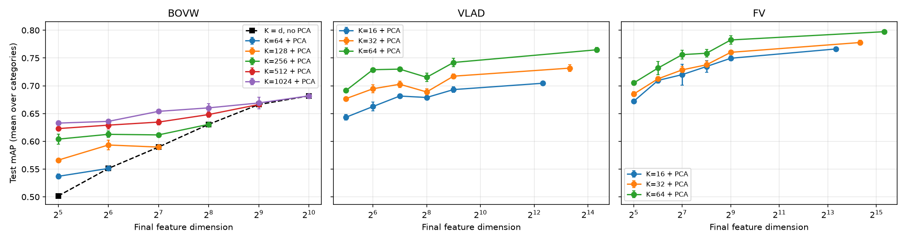

# Part 3 — Large visual vocabularies with PCA vs. smaller vocabularies

## Stage A — conditions A–D (BoVW)

> The assignment's table. A: small codebook (K = 256), no PCA. B: large codebook (K = 1024), no PCA. C: the large codebook + PCA to d. D: a codebook with K = d (C's final dimension), no PCA.

| condition   | encoding      | PCA d   |   dim | mAP           |   accuracy |   macro_F1 |   codebook_fit_s |   extract_ms |   pca_fit_s |   svm_train_s |   infer_us |   kb_per_image |
|:------------|:--------------|:--------|------:|:--------------|-----------:|-----------:|-----------------:|-------------:|------------:|--------------:|-----------:|---------------:|
| A           | bovw_K256_C0  | none    |   256 | 0.631 ± 0.004 |      0.855 |      0.699 |           31.093 |      180.323 |       0.000 |         0.018 |      0.057 |          1.000 |
| B           | bovw_K1024_C0 | none    |  1024 | 0.682 ± 0.003 |      0.868 |      0.755 |           87.136 |      304.102 |       0.000 |         0.073 |      0.179 |          4.000 |
| C           | bovw_K1024_C0 | 32      |    32 | 0.633 ± 0.004 |      0.855 |      0.714 |           87.136 |      304.102 |       0.036 |         0.003 |      1.228 |          0.125 |
| C           | bovw_K1024_C0 | 64      |    64 | 0.636 ± 0.002 |      0.856 |      0.743 |           87.136 |      304.102 |       0.056 |         0.005 |      1.682 |          0.250 |
| C           | bovw_K1024_C0 | 128     |   128 | 0.654 ± 0.002 |      0.856 |      0.747 |           87.136 |      304.102 |       0.085 |         0.009 |      2.474 |          0.500 |
| C           | bovw_K1024_C0 | 256     |   256 | 0.660 ± 0.007 |      0.859 |      0.757 |           87.136 |      304.102 |       0.182 |         0.018 |      4.250 |          1.000 |
| C           | bovw_K1024_C0 | 512     |   512 | 0.669 ± 0.011 |      0.859 |      0.760 |           87.136 |      304.102 |       0.395 |         0.038 |      9.160 |          2.000 |
| D           | bovw_K32_C0   | none    |    32 | 0.502 ± 0.001 |      0.828 |      0.601 |           28.187 |      157.209 |       0.000 |         0.004 |      0.011 |          0.125 |
| D           | bovw_K64_C0   | none    |    64 | 0.551 ± 0.003 |      0.840 |      0.623 |           54.183 |      149.187 |       0.000 |         0.006 |      0.017 |          0.250 |
| D           | bovw_K128_C0  | none    |   128 | 0.590 ± 0.004 |      0.848 |      0.644 |           19.083 |      159.411 |       0.000 |         0.010 |      0.030 |          0.500 |
| D           | bovw_K256_C0  | none    |   256 | 0.631 ± 0.004 |      0.855 |      0.699 |           31.093 |      180.323 |       0.000 |         0.018 |      0.057 |          1.000 |
| D           | bovw_K512_C0  | none    |   512 | 0.666 ± 0.004 |      0.864 |      0.735 |           63.996 |      221.215 |       0.000 |         0.036 |      0.123 |          2.000 |

## Q1 — larger codebook, before PCA

> Test AP per category without PCA, as K grows.

| encoding      |   motorbike |   aeroplane |   person |   horse |   car |   mAP |
|:--------------|------------:|------------:|---------:|--------:|------:|------:|
| bovw_K32_C0   |       0.281 |       0.631 |    0.648 |   0.307 | 0.641 | 0.502 |
| bovw_K64_C0   |       0.324 |       0.627 |    0.696 |   0.441 | 0.668 | 0.551 |
| bovw_K128_C0  |       0.364 |       0.642 |    0.734 |   0.509 | 0.700 | 0.590 |
| bovw_K256_C0  |       0.429 |       0.671 |    0.742 |   0.594 | 0.717 | 0.631 |
| bovw_K512_C0  |       0.516 |       0.679 |    0.747 |   0.644 | 0.746 | 0.666 |
| bovw_K1024_C0 |       0.545 |       0.678 |    0.758 |   0.673 | 0.755 | 0.682 |
| vlad_K16_C80  |       0.658 |       0.687 |    0.760 |   0.666 | 0.752 | 0.705 |
| vlad_K32_C80  |       0.695 |       0.724 |    0.766 |   0.695 | 0.780 | 0.732 |
| vlad_K64_C80  |       0.762 |       0.763 |    0.793 |   0.708 | 0.798 | 0.765 |
| fv_K16_C80    |       0.768 |       0.722 |    0.797 |   0.757 | 0.788 | 0.766 |
| fv_K32_C80    |       0.778 |       0.749 |    0.810 |   0.754 | 0.799 | 0.778 |
| fv_K64_C80    |       0.806 |       0.778 |    0.816 |   0.768 | 0.819 | 0.797 |

## Q2 — how much PCA keeps

> Test mAP for every final dimension d (`none` = no PCA). A row is one codebook; reading it from right to left shows how far PCA can go before mAP drops.

| encoding      | 32            | 64            | 128           | 256           | 512           | none          |
|:--------------|:--------------|:--------------|:--------------|:--------------|:--------------|:--------------|
| bovw_K32_C0   | –             | –             | –             | –             | –             | 0.502 ± 0.001 |
| bovw_K64_C0   | 0.537 ± 0.004 | –             | –             | –             | –             | 0.551 ± 0.003 |
| bovw_K128_C0  | 0.566 ± 0.002 | 0.593 ± 0.009 | –             | –             | –             | 0.590 ± 0.004 |
| bovw_K256_C0  | 0.604 ± 0.009 | 0.613 ± 0.006 | 0.612 ± 0.004 | –             | –             | 0.631 ± 0.004 |
| bovw_K512_C0  | 0.623 ± 0.003 | 0.629 ± 0.007 | 0.635 ± 0.005 | 0.648 ± 0.005 | –             | 0.666 ± 0.004 |
| bovw_K1024_C0 | 0.633 ± 0.004 | 0.636 ± 0.002 | 0.654 ± 0.002 | 0.660 ± 0.007 | 0.669 ± 0.011 | 0.682 ± 0.003 |
| vlad_K16_C80  | 0.643 ± 0.005 | 0.663 ± 0.008 | 0.682 ± 0.003 | 0.679 ± 0.004 | 0.693 ± 0.005 | 0.705 ± 0.003 |
| vlad_K32_C80  | 0.677 ± 0.002 | 0.695 ± 0.007 | 0.703 ± 0.006 | 0.689 ± 0.006 | 0.717 ± 0.004 | 0.732 ± 0.006 |
| vlad_K64_C80  | 0.691 ± 0.003 | 0.729 ± 0.002 | 0.730 ± 0.002 | 0.715 ± 0.008 | 0.742 ± 0.007 | 0.765 ± 0.004 |
| fv_K16_C80    | 0.672 ± 0.003 | 0.710 ± 0.005 | 0.720 ± 0.019 | 0.735 ± 0.011 | 0.750 ± 0.004 | 0.766 ± 0.004 |
| fv_K32_C80    | 0.685 ± 0.004 | 0.713 ± 0.004 | 0.729 ± 0.007 | 0.738 ± 0.007 | 0.760 ± 0.003 | 0.778 ± 0.004 |
| fv_K64_C80    | 0.705 ± 0.004 | 0.732 ± 0.012 | 0.756 ± 0.008 | 0.759 ± 0.007 | 0.783 ± 0.008 | 0.797 ± 0.003 |

## Q3 — same final dimension: large codebook + PCA (C) vs. small codebook (D)

> BoVW test mAP. Each row is one final dimension; the first column is a codebook with K = d used directly, the others are larger codebooks reduced with PCA to d.

|   final dim |   D: K = d, no PCA | C: K = 64 + PCA   | C: K = 128 + PCA   | C: K = 256 + PCA   | C: K = 512 + PCA   |   C: K = 1024 + PCA |
|------------:|-------------------:|:------------------|:-------------------|:-------------------|:-------------------|--------------------:|
|          32 |              0.502 | 0.537             | 0.566              | 0.604              | 0.623              |               0.633 |
|          64 |              0.551 | –                 | 0.593              | 0.613              | 0.629              |               0.636 |
|         128 |              0.590 | –                 | –                  | 0.612              | 0.635              |               0.654 |
|         256 |              0.631 | –                 | –                  | –                  | 0.648              |               0.660 |
|         512 |              0.666 | –                 | –                  | –                  | –                  |               0.669 |

## Q4 — accuracy vs. memory and time

> Every codebook without PCA and with PCA to 128. The large representation is paid in full (codebook fit, SIFT + encoding) before PCA; PCA only lowers storage, SVM training and inference.

| encoding      | PCA d   |   dim |   kb_per_image | mAP           |   codebook_fit_s |   extract_ms |   pca_fit_s |   svm_train_s |   infer_us |
|:--------------|:--------|------:|---------------:|:--------------|-----------------:|-------------:|------------:|--------------:|-----------:|
| bovw_K32_C0   | none    |    32 |          0.125 | 0.502 ± 0.001 |           28.187 |      157.209 |       0.000 |         0.004 |      0.011 |
| bovw_K64_C0   | none    |    64 |          0.250 | 0.551 ± 0.003 |           54.183 |      149.187 |       0.000 |         0.006 |      0.017 |
| bovw_K128_C0  | none    |   128 |          0.500 | 0.590 ± 0.004 |           19.083 |      159.411 |       0.000 |         0.010 |      0.030 |
| bovw_K256_C0  | none    |   256 |          1.000 | 0.631 ± 0.004 |           31.093 |      180.323 |       0.000 |         0.018 |      0.057 |
| bovw_K256_C0  | 128     |   128 |          0.500 | 0.612 ± 0.004 |           31.093 |      180.323 |       0.045 |         0.009 |      1.112 |
| bovw_K512_C0  | none    |   512 |          2.000 | 0.666 ± 0.004 |           63.996 |      221.215 |       0.000 |         0.036 |      0.123 |
| bovw_K512_C0  | 128     |   128 |          0.500 | 0.635 ± 0.005 |           63.996 |      221.215 |       0.056 |         0.009 |      1.474 |
| bovw_K1024_C0 | none    |  1024 |          4.000 | 0.682 ± 0.003 |           87.136 |      304.102 |       0.000 |         0.073 |      0.179 |
| bovw_K1024_C0 | 128     |   128 |          0.500 | 0.654 ± 0.002 |           87.136 |      304.102 |       0.085 |         0.009 |      2.474 |
| vlad_K16_C80  | none    |  5120 |         20.000 | 0.705 ± 0.003 |            1.888 |      159.121 |       0.000 |         0.454 |      0.805 |
| vlad_K16_C80  | 128     |   128 |          0.500 | 0.682 ± 0.003 |            1.888 |      159.121 |       0.220 |         0.008 |      8.785 |
| vlad_K32_C80  | none    | 10240 |         40.000 | 0.732 ± 0.006 |            5.506 |      161.431 |       0.000 |         0.880 |      1.624 |
| vlad_K32_C80  | 128     |   128 |          0.500 | 0.703 ± 0.006 |            5.506 |      161.431 |       0.443 |         0.009 |     20.892 |
| vlad_K64_C80  | none    | 20480 |         80.000 | 0.765 ± 0.004 |            8.098 |      166.116 |       0.000 |         1.369 |      3.320 |
| vlad_K64_C80  | 128     |   128 |          0.500 | 0.730 ± 0.002 |            8.098 |      166.116 |       0.836 |         0.010 |     40.429 |
| fv_K16_C80    | none    | 10304 |         40.250 | 0.766 ± 0.004 |           14.686 |      197.707 |       0.000 |         1.070 |      1.729 |
| fv_K16_C80    | 128     |   128 |          0.500 | 0.720 ± 0.019 |           14.686 |      197.707 |       0.454 |         0.010 |     20.427 |
| fv_K32_C80    | none    | 20608 |         80.500 | 0.778 ± 0.004 |           36.302 |      202.622 |       0.000 |         2.095 |      4.135 |
| fv_K32_C80    | 128     |   128 |          0.500 | 0.729 ± 0.007 |           36.302 |      202.622 |       0.773 |         0.009 |     39.212 |
| fv_K64_C80    | none    | 41216 |        161.000 | 0.797 ± 0.003 |           55.741 |      233.762 |       0.000 |         3.074 |      9.595 |
| fv_K64_C80    | 128     |   128 |          0.500 | 0.756 ± 0.008 |           55.741 |      233.762 |       1.688 |         0.010 |     84.627 |

## Q5 — BoVW vs. VLAD / Fisher Vector

> Share of dimensions removed and of mAP kept when each representation is reduced to the same d = 128. BoVW, VLAD and FV dimensions are not interchangeable: VLAD / FV grow with K × 80, so the same d removes far more of them.

| encoding      |   orig_dim |   mAP (no PCA) |   mAP (d = 128) |   removed_% |   mAP kept_% |
|:--------------|-----------:|---------------:|----------------:|------------:|-------------:|
| bovw_K256_C0  |        256 |          0.631 |           0.612 |      50.000 |       96.988 |
| bovw_K512_C0  |        512 |          0.666 |           0.635 |      75.000 |       95.255 |
| bovw_K1024_C0 |       1024 |          0.682 |           0.654 |      87.500 |       95.910 |
| vlad_K16_C80  |       5120 |          0.705 |           0.682 |      97.500 |       96.731 |
| vlad_K32_C80  |      10240 |          0.732 |           0.703 |      98.750 |       96.035 |
| vlad_K64_C80  |      20480 |          0.765 |           0.730 |      99.375 |       95.452 |
| fv_K16_C80    |      10304 |          0.766 |           0.720 |      98.758 |       93.973 |
| fv_K32_C80    |      20608 |          0.778 |           0.729 |      99.379 |       93.674 |
| fv_K64_C80    |      41216 |          0.797 |           0.756 |      99.689 |       94.822 |

