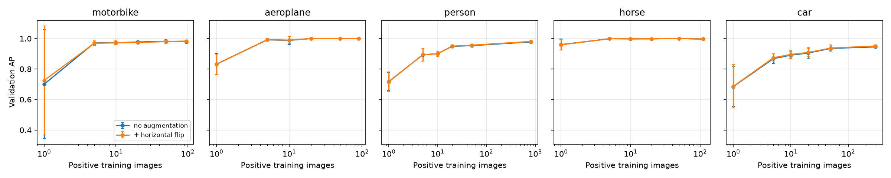
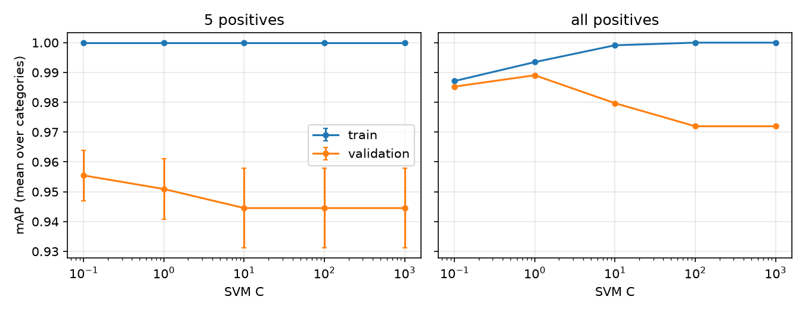
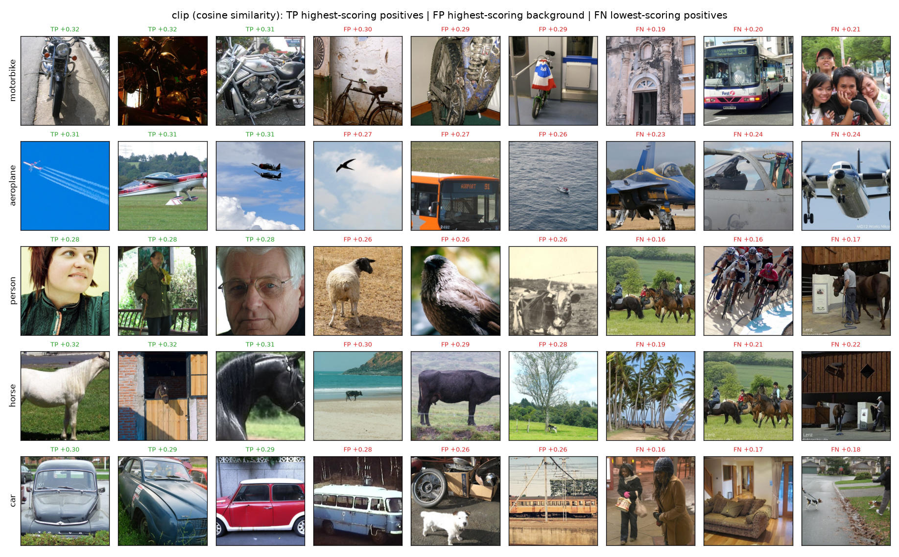
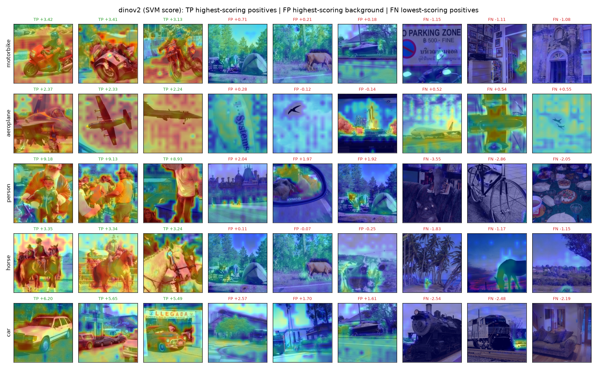
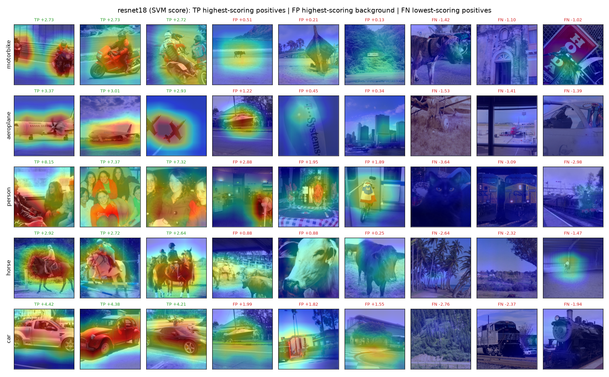

# Part 4 — Pretrained visual representations: CNN, DINOv2 and CLIP

## Stage A — Frozen ResNet-18 features

Test AP per encoding and feature map:

| encoding        | feature_map   |   motorbike |   aeroplane |   person |   horse |   car |   mAP |
|:----------------|:--------------|------------:|------------:|---------:|--------:|------:|------:|
| resnet18_layer2 | none          |       0.791 |       0.783 |    0.862 |   0.712 | 0.800 | 0.790 |
| resnet18_layer2 | l2            |       0.767 |       0.768 |    0.857 |   0.725 | 0.786 | 0.781 |
| resnet18_layer2 | sqrt_l2       |       0.767 |       0.734 |    0.842 |   0.722 | 0.763 | 0.766 |
| resnet18_layer3 | none          |       0.900 |       0.883 |    0.960 |   0.853 | 0.888 | 0.897 |
| resnet18_layer3 | l2            |       0.894 |       0.881 |    0.963 |   0.876 | 0.902 | 0.903 |
| resnet18_layer3 | sqrt_l2       |       0.911 |       0.846 |    0.963 |   0.874 | 0.894 | 0.898 |
| resnet18_layer4 | none          |       0.962 |       0.964 |    0.958 |   0.941 | 0.918 | 0.949 |
| resnet18_layer4 | l2            |       0.974 |       0.968 |    0.973 |   0.954 | 0.954 | 0.964 |
| resnet18_layer4 | sqrt_l2       |       0.980 |       0.969 |    0.971 |   0.960 | 0.957 | 0.968 |
| bovw_K512_C0    | sqrt_l2       |       0.632 |       0.691 |    0.750 |   0.662 | 0.734 | 0.694 |
| vlad_K32_C80    | ssr_intra_l2  |       0.707 |       0.726 |    0.768 |   0.735 | 0.793 | 0.746 |
| fv_K32_C80      | ssr_l2        |       0.783 |       0.759 |    0.811 |   0.758 | 0.807 | 0.784 |

Selected feature map per encoding (on mean validation AP), with dimension, storage and cost (`extract_ms_per_image`: forward pass for the deep models, SIFT + encoding for the baselines):

| encoding        |   dim | dtype   |   kb_per_image |   disk_mb |   extract_ms_per_image | device   | feature_map   |   train_time_s |   infer_ms_per_image |   mAP |
|:----------------|------:|:--------|---------------:|----------:|-----------------------:|:---------|:--------------|---------------:|---------------------:|------:|
| resnet18_layer2 |   128 | float32 |          0.500 |     4.825 |                 18.257 | cpu      | l2            |          0.011 |                0.001 | 0.781 |
| resnet18_layer3 |   256 | float32 |          1.000 |     9.759 |                 18.257 | cpu      | l2            |          0.017 |                0.002 | 0.903 |
| resnet18_layer4 |   512 | float32 |          2.000 |    19.720 |                 18.257 | cpu      | l2            |          0.026 |                0.003 | 0.964 |
| bovw_K512_C0    |  2048 | int64   |         16.000 |    11.960 |                239.594 | cpu      | sqrt_l2       |          0.145 |                0.019 | 0.694 |
| vlad_K32_C80    | 10240 | float32 |         40.000 |   199.480 |                207.029 | cpu      | ssr_intra_l2  |          0.724 |                0.227 | 0.746 |
| fv_K32_C80      | 20608 | float64 |        161.000 |   837.738 |                295.513 | cpu      | ssr_l2        |          2.094 |                0.361 | 0.784 |

## Stage B — DINOv2 ViT-S/14

Test AP per encoding and feature map:

| encoding                | feature_map   |   motorbike |   aeroplane |   person |   horse |   car |   mAP |
|:------------------------|:--------------|------------:|------------:|---------:|--------:|------:|------:|
| dinov2_vits14_cls       | none          |       0.974 |       1.000 |    0.966 |   0.993 | 0.926 | 0.972 |
| dinov2_vits14_cls       | l2            |       0.982 |       1.000 |    0.978 |   0.994 | 0.951 | 0.981 |
| dinov2_vits14_patchmean | none          |       0.981 |       1.000 |    0.978 |   0.984 | 0.956 | 0.980 |
| dinov2_vits14_patchmean | l2            |       0.980 |       1.000 |    0.988 |   0.985 | 0.967 | 0.984 |
| resnet18_layer4         | none          |       0.962 |       0.964 |    0.958 |   0.941 | 0.918 | 0.949 |
| resnet18_layer4         | l2            |       0.974 |       0.968 |    0.973 |   0.954 | 0.954 | 0.964 |
| clip_vit_b_32           | none          |       0.994 |       0.998 |    0.985 |   0.992 | 0.970 | 0.988 |
| clip_vit_b_32           | l2            |       0.994 |       0.998 |    0.991 |   0.992 | 0.979 | 0.991 |

Selected feature map per encoding (on mean validation AP), with dimension, storage and cost (`extract_ms_per_image`: forward pass for the deep models, SIFT + encoding for the baselines):

| encoding                |   dim | dtype   |   kb_per_image |   disk_mb |   extract_ms_per_image | device   | feature_map   |   train_time_s |   infer_ms_per_image |   mAP |
|:------------------------|------:|:--------|---------------:|----------:|-----------------------:|:---------|:--------------|---------------:|---------------------:|------:|
| dinov2_vits14_cls       |   384 | float32 |          1.500 |    15.199 |                 52.278 | cpu      | l2            |          0.020 |                0.003 | 0.981 |
| dinov2_vits14_patchmean |   384 | float32 |          1.500 |    15.220 |                 52.278 | cpu      | l2            |          0.017 |                0.003 | 0.984 |
| resnet18_layer4         |   512 | float32 |          2.000 |    19.720 |                 18.257 | cpu      | l2            |          0.029 |                0.004 | 0.964 |
| clip_vit_b_32           |   512 | float32 |          2.000 |    20.268 |                 35.182 | cpu      | l2            |          0.024 |                0.004 | 0.991 |

Confusion matrix (test) — `clip_vit_b_32` (rows: true, columns: predicted):

| true       |   motorbike |   aeroplane |   person |   horse |   car |   background |
|:-----------|------------:|------------:|---------:|--------:|------:|-------------:|
| motorbike  |          29 |           0 |        3 |       0 |     3 |            2 |
| aeroplane  |           0 |         107 |        0 |       0 |     3 |            2 |
| person     |           1 |           0 |      642 |       0 |     6 |           35 |
| horse      |           0 |           0 |        4 |      25 |     0 |            2 |
| car        |           0 |           0 |       15 |       0 |   200 |           13 |
| background |           1 |           2 |       35 |       0 |    17 |         1022 |

Confusion matrix (test) — `dinov2_vits14_cls` (rows: true, columns: predicted):

| true       |   motorbike |   aeroplane |   person |   horse |   car |   background |
|:-----------|------------:|------------:|---------:|--------:|------:|-------------:|
| motorbike  |           8 |           0 |        8 |       0 |    18 |            3 |
| aeroplane  |           0 |          81 |       24 |       0 |     7 |            0 |
| person     |           0 |           1 |      625 |       0 |    10 |           48 |
| horse      |           0 |           0 |        5 |      23 |     0 |            3 |
| car        |           1 |           0 |       37 |       0 |   171 |           19 |
| background |           0 |           2 |       67 |       0 |    25 |          983 |

Confusion matrix (test) — `dinov2_vits14_patchmean` (rows: true, columns: predicted):

| true       |   motorbike |   aeroplane |   person |   horse |   car |   background |
|:-----------|------------:|------------:|---------:|--------:|------:|-------------:|
| motorbike  |          21 |           0 |        7 |       0 |     6 |            3 |
| aeroplane  |           0 |          87 |       14 |       0 |    11 |            0 |
| person     |           1 |           1 |      617 |       0 |    15 |           50 |
| horse      |           0 |           0 |        3 |      24 |     1 |            3 |
| car        |           1 |           1 |       37 |       0 |   173 |           16 |
| background |           1 |           0 |       31 |       0 |    24 |         1021 |

Confusion matrix (test) — `resnet18_layer4` (rows: true, columns: predicted):

| true       |   motorbike |   aeroplane |   person |   horse |   car |   background |
|:-----------|------------:|------------:|---------:|--------:|------:|-------------:|
| motorbike  |          13 |           0 |       15 |       0 |     2 |            7 |
| aeroplane  |           1 |          97 |        4 |       0 |     4 |            6 |
| person     |           0 |           2 |      591 |       2 |    12 |           77 |
| horse      |           0 |           0 |        4 |      18 |     0 |            9 |
| car        |           2 |           3 |       26 |       0 |   171 |           26 |
| background |           1 |           5 |       54 |       7 |    19 |          991 |

## Stage C — few-shot learning and flip augmentation

Validation AP (mean ± std over random draws of the positives) against the number of positive training images. Negatives: every background training image. `flip` adds the flipped training images; validation images are never flipped. `all` is a single draw.

| category   | aug   | 1             | 5             | 10            | 20            | 50            |   all |
|:-----------|:------|:--------------|:--------------|:--------------|:--------------|:--------------|------:|
| aeroplane  | flip  | 0.831 ± 0.067 | 0.993 ± 0.008 | 0.989 ± 0.024 | 1.000 ± 0.000 | 1.000 ± 0.000 | 1.000 |
| aeroplane  | none  | 0.832 ± 0.071 | 0.992 ± 0.007 | 0.988 ± 0.027 | 1.000 ± 0.000 | 1.000 ± 0.000 | 1.000 |
| car        | flip  | 0.686 ± 0.142 | 0.874 ± 0.027 | 0.895 ± 0.028 | 0.909 ± 0.028 | 0.937 ± 0.020 | 0.951 |
| car        | none  | 0.685 ± 0.130 | 0.868 ± 0.032 | 0.891 ± 0.025 | 0.905 ± 0.035 | 0.935 ± 0.015 | 0.945 |
| horse      | flip  | 0.959 ± 0.033 | 0.999 ± 0.002 | 0.998 ± 0.005 | 0.998 ± 0.002 | 1.000 ± 0.001 | 0.997 |
| horse      | none  | 0.960 ± 0.036 | 0.999 ± 0.002 | 0.998 ± 0.005 | 0.998 ± 0.003 | 1.000 ± 0.001 | 0.997 |
| motorbike  | flip  | 0.725 ± 0.358 | 0.969 ± 0.016 | 0.972 ± 0.013 | 0.973 ± 0.006 | 0.980 ± 0.011 | 0.983 |
| motorbike  | none  | 0.701 ± 0.356 | 0.971 ± 0.015 | 0.973 ± 0.011 | 0.977 ± 0.005 | 0.982 ± 0.009 | 0.979 |
| person     | flip  | 0.716 ± 0.064 | 0.894 ± 0.042 | 0.900 ± 0.017 | 0.950 ± 0.009 | 0.956 ± 0.007 | 0.981 |
| person     | none  | 0.718 ± 0.058 | 0.894 ± 0.042 | 0.900 ± 0.016 | 0.949 ± 0.008 | 0.954 ± 0.005 | 0.978 |
| mAP        | flip  | 0.784 ± 0.057 | 0.946 ± 0.011 | 0.951 ± 0.004 | 0.966 ± 0.006 | 0.975 ± 0.006 | 0.982 |
| mAP        | none  | 0.779 ± 0.060 | 0.945 ± 0.013 | 0.950 ± 0.005 | 0.966 ± 0.007 | 0.974 ± 0.005 | 0.980 |

Test-time flip as a separate condition (all positives, validation AP): `score_avg` averages the SVM scores of an image and its flip, `feature_avg` scores the feature map of the mean raw feature.

| train_aug (mAP)   |   no_tta |   score_avg |   feature_avg |
|:------------------|---------:|------------:|--------------:|
| flip              |   0.9823 |      0.9816 |        0.9818 |
| none              |   0.9797 |      0.9796 |        0.9799 |

## Stage D — choice of the SVM C

Train and validation mAP (mean ± std over draws) per C, with 5 and with all positives.

| regime        |        C | ap_train      | ap_val        |
|:--------------|---------:|:--------------|:--------------|
| 5 positives   |    0.100 | 1.000 ± 0.000 | 0.955 ± 0.008 |
| 5 positives   |    1.000 | 1.000 ± 0.000 | 0.951 ± 0.010 |
| 5 positives   |   10.000 | 1.000 ± 0.000 | 0.945 ± 0.013 |
| 5 positives   |  100.000 | 1.000 ± 0.000 | 0.945 ± 0.013 |
| 5 positives   | 1000.000 | 1.000 ± 0.000 | 0.945 ± 0.013 |
| all positives |    0.100 | 0.987         | 0.985         |
| all positives |    1.000 | 0.993         | 0.989         |
| all positives |   10.000 | 0.999         | 0.980         |
| all positives |  100.000 | 1.000         | 0.972         |
| all positives | 1000.000 | 1.000         | 0.972         |

C selected per regime on validation mAP, evaluated once on the test set (test AP, mean over draws):

| regime        |     C |   aeroplane |   car |   horse |   motorbike |   person |   mAP |
|:--------------|------:|------------:|------:|--------:|------------:|---------:|------:|
| 5 positives   | 0.100 |       0.992 | 0.886 |   0.985 |       0.975 |    0.910 | 0.949 |
| all positives | 1.000 |       1.000 | 0.974 |   0.995 |       0.983 |    0.982 | 0.987 |

## Stage E — CLIP zero-shot classification

Validation AP per prompt set (ranking each category's positives vs. background by cosine similarity to the class text embedding). Only the best set is evaluated on test.

| prompt_set   |   prompts_per_class |   motorbike |   aeroplane |   person |   horse |   car |   mAP_val |
|:-------------|--------------------:|------------:|------------:|---------:|--------:|------:|----------:|
| name         |                   1 |       0.946 |       0.981 |    0.596 |   0.949 | 0.791 |     0.853 |
| photo        |                   1 |       0.916 |       1.000 |    0.656 |   0.885 | 0.827 |     0.857 |
| templates    |                   8 |       0.939 |       1.000 |    0.615 |   0.892 | 0.834 |     0.856 |
| synonyms     |                   2 |       0.921 |       1.000 |    0.610 |   0.884 | 0.803 |     0.844 |

Test AP: zero-shot with the selected prompts vs. the Part 1 linear SVM on the same CLIP image embeddings.

| category   |   zero_shot (photo) |   svm_on_clip |
|:-----------|--------------------:|--------------:|
| motorbike  |               0.889 |         0.994 |
| aeroplane  |               0.982 |         0.998 |
| person     |               0.583 |         0.991 |
| horse      |               0.811 |         0.992 |
| car        |               0.865 |         0.979 |
| mAP        |               0.826 |         0.991 |

Zero-shot classification of single-category test images (argmax over the 5 class prompts and a background prompt; rows: true, columns: predicted):

| true       |   motorbike |   aeroplane |   person |   horse |   car |   background |
|:-----------|------------:|------------:|---------:|--------:|------:|-------------:|
| motorbike  |          36 |           0 |        0 |       1 |     0 |            0 |
| aeroplane  |           0 |         112 |        0 |       0 |     0 |            0 |
| person     |          26 |          11 |      384 |      14 |    10 |          239 |
| horse      |           0 |           0 |        0 |      30 |     0 |            1 |
| car        |           3 |           1 |        0 |       0 |   165 |           59 |
| background |          31 |          42 |      288 |     106 |    32 |          578 |

| class        |   precision |   recall |   f1-score |   support |
|:-------------|------------:|---------:|-----------:|----------:|
| motorbike    |       0.375 |    0.973 |      0.541 |    37.000 |
| aeroplane    |       0.675 |    1.000 |      0.806 |   112.000 |
| person       |       0.571 |    0.561 |      0.566 |   684.000 |
| horse        |       0.199 |    0.968 |      0.330 |    31.000 |
| car          |       0.797 |    0.724 |      0.759 |   228.000 |
| background   |       0.659 |    0.537 |      0.592 |  1077.000 |
| accuracy     |       0.602 |    0.602 |      0.602 |     0.602 |
| macro avg    |       0.546 |    0.794 |      0.599 |  2169.000 |
| weighted avg |       0.635 |    0.602 |      0.608 |  2169.000 |

Costs:

| encoding      |   dim |   kb_per_image |   extract_ms_per_image | device   | prompt_set   |   num_prompts |   text_encode_s |   infer_us_per_image |
|:--------------|------:|---------------:|-----------------------:|:---------|:-------------|--------------:|----------------:|---------------------:|
| clip_vit_b_32 |   512 |         2.0000 |                35.1819 | cpu      | photo        |             6 |          0.2174 |               2.9475 |

## Stage F — visual analysis and failure cases

Per category: highest-scoring positives (TP), highest-scoring background images (FP) and lowest-scoring positives (FN) on the test set. ResNet-18 and DINOv2 maps are exact decompositions of the SVM score over image positions (positive part shown); CLIP has no map. Image ids and scores are in `part4_examples.csv`.

## Required comparison table

Test mAP over the 5 categories with the setting selected on validation. Extraction: SIFT + encoding (handcrafted, a few images) or one forward pass on CPU (deep). Inference: feature map + classifier (or text similarity) per image, excluding extraction.

| method                          | supervision                            |    mAP |   inference_ms_per_image |   dim |   extract_ms_per_image |
|:--------------------------------|:---------------------------------------|-------:|-------------------------:|------:|-----------------------:|
| resnet18_layer2                 | Pretrained (ImageNet) + task labels    | 0.7807 |                   0.0007 |   128 |                18.2571 |
| resnet18_layer3                 | Pretrained (ImageNet) + task labels    | 0.9032 |                   0.0016 |   256 |                18.2571 |
| resnet18_layer4                 | Pretrained (ImageNet) + task labels    | 0.9644 |                   0.0031 |   512 |                18.2571 |
| bovw_K512_C0                    | Task labels                            | 0.6937 |                   0.0195 |  2048 |               239.5936 |
| vlad_K32_C80                    | Task labels                            | 0.7458 |                   0.2271 | 10240 |               207.0287 |
| fv_K32_C80                      | Task labels                            | 0.7837 |                   0.3608 | 20608 |               295.5135 |
| dinov2_vits14_cls               | Self-supervised + task labels          | 0.9809 |                   0.0029 |   384 |                52.2783 |
| dinov2_vits14_patchmean         | Self-supervised + task labels          | 0.9841 |                   0.0031 |   384 |                52.2783 |
| clip_vit_b_32 zero_shot (photo) | Image-text pretraining, no task labels | 0.8259 |                   0.0029 |   512 |                35.1819 |

## Questions

**Stage A**

- How do learned features differ from handcrafted local descriptors? Does a higher-dimensional feature necessarily give better AP?
  - *Answer:*

**Stage B**

- Why can DINOv2 features be useful with few labeled examples even though DINOv2 is not trained as a classifier for these target categories?
  - *Answer:*
- What information might be lost when patch tokens are replaced by a single global descriptor?
  - *Answer:*

**Stage C**

- How much does pretrained representation quality reduce dependence on labeled examples?
  - *Answer:*
- When could horizontal flipping harm recognition? Is averaging feature vectors equivalent to averaging classifier scores?
  - *Answer:*

**Stage D**

- How does regularization affect the bias-variance trade-off when only a few positive examples are available?
  - *Answer:*

**Stage E**

- How does CLIP zero-shot recognition differ from a linear SVM trained on frozen CLIP image embeddings?
  - *Answer:*
- How sensitive are predictions to prompt wording? What are the risks of selecting prompts based on the test set?
  - *Answer:*

**Stage F**

- Do the highlighted regions correspond to the object? What can and cannot be concluded from a saliency visualization?
  - *Answer:*
- Which categories and visual conditions remain difficult, and what evidence supports your explanation?
  - *Answer:*

